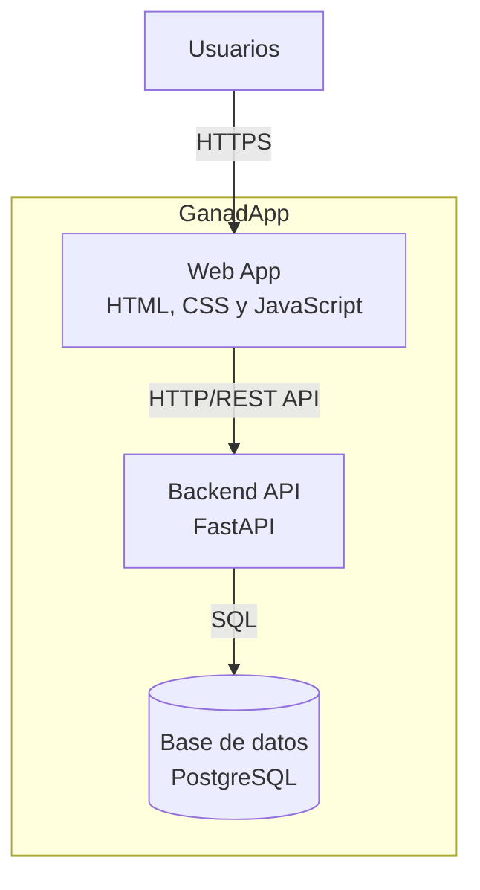

# C4 Nivel 2 — Contenedores

## Objetivo

Este diagrama representa la estructura interna de GanadApp a nivel de contenedores. Muestra los principales componentes que forman el sistema y las comunicaciones entre ellos.

El diagrama complementa al C4 Nivel 1 (Contexto), que representa cómo GanadApp se relaciona con sus usuarios y su sistema de persistencia.

## Diagrama

## Contenedores

### Web App

Aplicación web que constituye la interfaz de usuario de GanadApp. Está desarrollada con HTML, CSS y JavaScript. Permite a los usuarios acceder a las funcionalidades del sistema y comunicarse con el Backend API mediante HTTP/REST.

### Backend API

Backend de GanadApp desarrollado con FastAPI. Centraliza la lógica de negocio y proporciona los endpoints de la API utilizados por la Web App. También gestiona el acceso a los datos almacenados en PostgreSQL.

### Base de datos PostgreSQL

Sistema de persistencia utilizado para almacenar los datos de GanadApp. El Backend API accede a la base de datos mediante SQL.

## Comunicaciones

Los usuarios interactúan con GanadApp a través de la Web App.

La Web App se comunica con el Backend API mediante HTTP/REST.

El Backend API se comunica con PostgreSQL mediante SQL para almacenar y recuperar los datos del sistema.