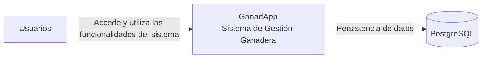

# C4 - Nivel Contexto (GanadApp)

## Diagrama

## Descripción del sistema

GanadApp es un sistema de gestión ganadera orientado a productores rurales de Malargüe. Permite centralizar y organizar la información relacionada con animales, establecimientos, eventos sanitarios, stock y trazabilidad.

El sistema permite que múltiples usuarios accedan a las mismas funcionalidades y trabajen sobre los establecimientos registrados.

## Actores

Usuarios: personas que poseen una cuenta y acceden a GanadApp para registrar, consultar y actualizar información de la gestión ganadera. Todos cuentan con las mismas funcionalidades, sin diferenciación por roles.

## Sistema de persistencia

Base de datos PostgreSQL: almacena la información del sistema, incluyendo usuarios, productores, establecimientos, animales, eventos sanitarios y stock de insumos.
